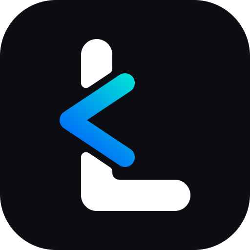

# Libregram Desktop

### Твой Telegram. Больше свободы.

Открытый настольный Telegram-клиент для тех, кто хочет настроить приложение под себя — и управлять тем, как оно подключается к сети.

[Идея](#зачем-libregram) · [Возможности](#что-хотим-сделать) · [Статус](#статус-разработки) · [Документация](#документация)

> [!IMPORTANT]
> Libregram находится на ранней стадии разработки. Ниже описано направление проекта, а не список уже готовых возможностей. Наличие исходников и сборочных сценариев не означает, что приложение прошло сборку и тестирование.

## Зачем Libregram

Мы хотим сделать Telegram-клиент, в котором **стабильность, кастомизация и удобное подключение** важнее количества переключателей.

Не заставлять пользователя запускать отдельные утилиты ради подключения. Не ограничивать оформление несколькими цветами. Не добавлять функции только ради длинного списка в README.

Идея Libregram проста: привычный мессенджер, который можно сделать своим — с понятными настройками, полезными локальными возможностями и открытым исходным кодом.

Проект развивается на базе **Telegram Desktop**, с использованием наработок **Kotatogram**. Мы сохраняем происхождение кода и хотим развивать собственный клиент, а не просто менять название исходного приложения.

## Что хотим сделать

### Подключение без лишней возни

**LibreProxy** — планируемая интеграция [Flowseal/tg-ws-proxy](https://github.com/Flowseal/tg-ws-proxy) прямо в приложение.

Цель — управлять встроенным прокси из отдельного раздела настроек, без необходимости вручную запускать его в терминале:

- включение и отключение по желанию пользователя;
- понятное состояние подключения и сообщения об ошибках;
- настройка и управление локальным процессом из клиента;
- корректное завершение прокси вместе с приложением.

Способ интеграции ещё предстоит проверить и реализовать. Это дополнительный способ подключения, а не обещание работы в любой сети или анонимности. Существующие наработки WEB proxy описаны отдельно и не означают готовую интеграцию tg-ws-proxy.

### Оформление под себя

**LibreTheme** — направление развития кастомизации интерфейса.

Хотим дать больше контроля над цветами, шрифтами, размерами элементов, обоями и анимациями. Начать с понятных настроек и сохранения пользовательского оформления; более гибкие форматы тем рассматривать после появления стабильной основы.

Кастомизация должна помогать пользоваться клиентом, а не превращать обновление темы в ремонт приложения.

### Удобная работа с профилями

В репозитории уже есть исходники менеджера отдельных рабочих профилей: создание, поиск, отдельный запуск, избранное, группы, метки и архивирование.

Следующий шаг — проверить реализацию и сохранность данных на практике. Отдельные профили приложения не следует путать с одновременной работой сотен аккаунтов внутри одного окна.

### Полезные локальные улучшения

Хотим постепенно улучшать повседневные сценарии: настройки интерфейса, быстрые действия, работу с медиа и управление локальными данными.

Это именно возможности клиента. Libregram **не разблокирует Telegram Premium** и не обещает обход серверных ограничений Telegram.

## Сначала стабильность

Наша цель — не самый длинный список функций, а клиент, которым удобно пользоваться каждый день.

- **Базовые сценарии прежде всего.** Вход, сообщения, медиа и перезапуск должны работать надёжно.
- **Данные важнее экспериментов.** Изменения хранения и обновления требуют отдельной проверки.
- **Дополнительные функции — по выбору.** Прокси и визуальные эффекты не должны быть обязательными.
- **Честный статус.** План, код в репозитории и проверенная возможность — разные стадии.
- **Открытая разработка.** Изменения должны быть понятными и проверяемыми.

## Платформы и сборка

**Первый приоритет — Linux.** Начальная цель для пакетирования и проверки — Arch Linux / CachyOS, x86_64.

Сборочная система проекта основана на CMake. Планируем проверять сборку с **Clang и GCC**; совместимость обоих вариантов ещё не подтверждена. В репозитории есть PKGBUILD и сценарии CI, но они сами по себе не подтверждают успешную сборку.

В дальнейшем хотим расширять поддержку дистрибутивов, архитектур и других настольных ОС. Конкретные платформы будем объявлять по мере появления проверенных сборок. Мобильная версия пока не входит в текущий этап.

Инструкции: [Linux](docs/building-linux.md) · [Arch / CachyOS](packaging/arch/README.md) · [план первого выпуска](docs/CACHYOS_RELEASE.md).

## Статус разработки

| Направление | Сейчас |
|---|---|
| Название и визуальный стиль | Ресурсы брендинга добавлены; отображение в приложении требует проверки |
| Базовая Linux-сборка | Работоспособность не подтверждена |
| Пакет Arch / CachyOS | PKGBUILD подготовлен; сборка и установка требуют проверки |
| Менеджер профилей | Код добавлен; нужна проверка реализации и поведения |
| LibreProxy / tg-ws-proxy | Планируется |
| Расширенная кастомизация | Планируется |
| Другие платформы | После стабилизации Linux-версии |

### Ближайший маршрут

1. Проверить исходники, зависимости и воспроизводимость Linux-сборки.
2. Получить запускаемый клиент и проверить базовые сценарии и профили.
3. Подготовить отдельный раздел настроек Libregram.
4. Реализовать и протестировать прототип интеграции tg-ws-proxy.
5. Постепенно добавлять кастомизацию и готовить первую публичную тестовую версию.

Без обещаний сроков: готовность определяется проверками, а не датой в README.

## Документация

Документы отражают текущее проектирование и могут содержать более долгосрочные идеи. Они не являются подтверждением готовности функций.

| Документ | О чём |
|---|---|
| [Концепция](docs/PRODUCT.md) | Идеи, возможности и ограничения |
| [Архитектура](docs/architecture.md) | Устройство проекта |
| [Дорожная карта](docs/ROADMAP.md) | Этапы разработки |
| [Аудит исходной базы](docs/UPSTREAM_AUDIT.md) | Существующие наработки и точки расширения |
| [Брендинг](docs/BRANDING.md) | Логотип и ресурсы приложения |
| [Профили](docs/MULTI_ACCOUNT.md) | Менеджер рабочих профилей |
| [Сборка Linux](docs/building-linux.md) | Инструкция по сборке исходной базы |
| [Пакет Arch / CachyOS](packaging/arch/README.md) | Подготовка нативного пакета |
| [Первый Linux-релиз](docs/CACHYOS_RELEASE.md) | Условия готовности выпуска |
| [Telegram API credentials](docs/api_credentials.md) | Настройка реквизитов API для сборки |
| [Унаследованный WEB proxy](docs/web-proxy-plan.md) | Отдельный механизм, не готовый LibreProxy |

## Участие

На этом этапе особенно полезны воспроизводимые отчёты об ошибках сборки, проверка Linux-совместимости и небольшие, понятные исправления.

В отчёте указывайте дистрибутив, архитектуру, компилятор, коммит и шаги воспроизведения. Не публикуйте сессии, содержимое `tdata`, API hash и другие чувствительные данные; проверяйте логи перед отправкой.

## Происхождение и лицензия

Libregram основан на открытом коде [Telegram Desktop](https://github.com/telegramdesktop/tdesktop) и использует наработки [Kotatogram Desktop](https://github.com/kotatogram/kotatogram-desktop). Благодарим авторов и участников этих проектов.

Код распространяется на условиях **GNU GPL v3.0**, см. [LICENSE](LICENSE). При распространении необходимо соблюдать условия лицензий заимствованного кода и компонентов, сохранять авторские уведомления и предоставлять соответствующий исходный код в предусмотренном лицензией порядке. Интеграция сторонних компонентов также требует соблюдения их лицензий.

Libregram — независимый неофициальный клиент. Проект не связан с Telegram и не является его официальным продуктом.

---

**Привычное общение. Собственный интерфейс. Больше контроля.**

Linux first · Open source · Early development

