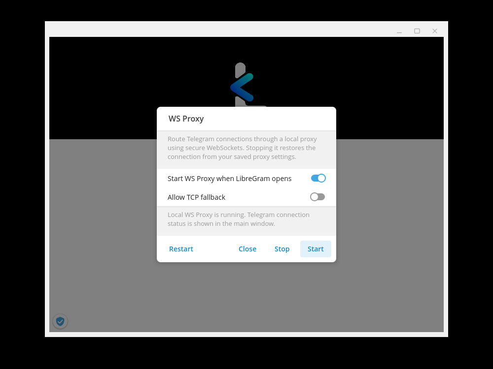

<div align="center">


# LibreGram Desktop

**An experimental Telegram Desktop fork with a familiar Kotatogram-inspired experience.**

[](https://github.com/W0rd3r566/libregram-desktop/tree/main)
[](LICENSE)

[LibreGram on Telegram](https://t.me/libregramm)

</div>

> **Project status:** experimental. LibreGram is under active development. Interfaces, build steps, and project structure may change.

LibreGram Desktop is an independent project based on the Telegram Desktop codebase and the Kotatogram fork. The goal is to build on the familiar desktop experience while developing LibreGram-specific improvements.

LibreGram is **not affiliated with Telegram** or Telegram FZ-LLC.

LibreGram adds native settings, the Graphite theme, and a [WS Proxy](docs/libregram/ws-proxy.md) switch with optional auto-start. The [profile manager](docs/MULTI_ACCOUNT.md) opens independent workspaces with their own data.

## Скачать

[LibreGram Desktop 0.1.0 beta 1 · GitHub Releases](https://github.com/W0rd3r566/libregram-desktop/releases/tag/v0.1.0-beta.1)

| Дистрибутив или ОС | Пакет для x86-64 |
| --- | --- |
| Arch Linux, CachyOS | [Пакет для pacman](https://github.com/W0rd3r566/libregram-desktop/releases/download/v0.1.0-beta.1/libregram-0.1.0beta1-1-x86_64.pkg.tar.zst) |
| Ubuntu 24.04 и 26.04, Debian 12 и 13 | [Пакет .deb](https://github.com/W0rd3r566/libregram-desktop/releases/download/v0.1.0-beta.1/libregram-desktop_0.1.0.beta.1_amd64.deb) |
| NixOS с flakes | [Архив .tar.gz](https://github.com/W0rd3r566/libregram-desktop/releases/download/v0.1.0-beta.1/LibreGram-NixOS-x86_64-flakes.tar.gz) · [Установка](docs/libregram/install.md#nixos-с-flakes) |
| NixOS без flakes | [Архив .tar.gz](https://github.com/W0rd3r566/libregram-desktop/releases/download/v0.1.0-beta.1/LibreGram-NixOS-x86_64-no-flakes.tar.gz) · [Установка](docs/libregram/install.md#nixos-без-flakes) |
| Другие Linux с glibc | [Переносной архив .tar.xz](https://github.com/W0rd3r566/libregram-desktop/releases/download/v0.1.0-beta.1/LibreGram-0.1.0-beta.1-linux-x86_64.tar.xz) |
| Windows ARM64 | Portable `.zip` и установщик `.exe` после проверки сборки |
| Windows x64 | Portable `.zip` и установщик `.exe` после проверки сборки |
| Windows x86 (32 бит) | Portable `.zip` и установщик `.exe` после проверки сборки |

### Команды скачивания

Команды сохраняют файл в текущей папке.

**Arch Linux и CachyOS**

```bash
curl -fLO 'https://github.com/W0rd3r566/libregram-desktop/releases/download/v0.1.0-beta.1/libregram-0.1.0beta1-1-x86_64.pkg.tar.zst'
```

**Ubuntu 24.04 и 26.04, Debian 12 и 13**

```bash
curl -fLO 'https://github.com/W0rd3r566/libregram-desktop/releases/download/v0.1.0-beta.1/libregram-desktop_0.1.0.beta.1_amd64.deb'
```

**NixOS с flakes**

```bash
curl -fLO 'https://github.com/W0rd3r566/libregram-desktop/releases/download/v0.1.0-beta.1/LibreGram-NixOS-x86_64-flakes.tar.gz'
```

**NixOS без flakes**

```bash
curl -fLO 'https://github.com/W0rd3r566/libregram-desktop/releases/download/v0.1.0-beta.1/LibreGram-NixOS-x86_64-no-flakes.tar.gz'
```

**Другие Linux с glibc**

```bash
curl -fLO 'https://github.com/W0rd3r566/libregram-desktop/releases/download/v0.1.0-beta.1/LibreGram-0.1.0-beta.1-linux-x86_64.tar.xz'
```

## Быстрый старт

Выполняйте команды установки из папки, куда скачали пакет.

**Arch Linux и CachyOS**

```bash
sudo pacman -U ./libregram-0.1.0beta1-1-x86_64.pkg.tar.zst
```

**Ubuntu и Debian**

```bash
sudo apt install ./libregram-desktop_0.1.0.beta.1_amd64.deb
```

После установки откройте LibreGram из меню приложений.

**NixOS**

Выберите инструкцию [с flakes](docs/libregram/install.md#nixos-с-flakes) или [без flakes](docs/libregram/install.md#nixos-без-flakes). После установки запустите `LibreGram`.

**Переносной архив Linux**

Распакуйте архив и запустите `./LibreGram` из распакованной папки. Оставьте `libregram-ws-proxy` рядом с клиентом.

### Как включить WS Proxy

1. Откройте главное меню и включите **WS Proxy**. До входа в аккаунт его можно включить из списка прокси на экране входа.
2. Для автозапуска откройте **Настройки → LibreGram Settings → WS Proxy** и включите **Start WS Proxy when LibreGram opens**. [Подробнее о WS Proxy](docs/libregram/ws-proxy.md)



## Обратная связь

Сообщайте об ошибках в [GitHub Issues](https://github.com/W0rd3r566/libregram-desktop/issues). Укажите версию LibreGram, ОС и архитектуру, а также шаги, после которых возникает ошибка.

Новости проекта и релизов публикуются в [Telegram-канале LibreGram](https://t.me/libregramm).

## What the current codebase brings

The inherited Kotatogram feature set includes:

- Local chat folders
- Forwarding to multiple chats
- Compact chat list
- Custom fonts and text replacements
- Adjustable chat bubbles

These describe capabilities from the upstream base. They are not a promise that every feature has been redesigned or independently maintained by LibreGram.

## Build from source

Build instructions currently focus on Linux and Windows:

| Platform | Guide |
|:--|:--|
| Linux | [Build with Docker](docs/building-linux.md) |
| Windows | [Build with Visual Studio](docs/building-win.md) |

You need your own Telegram API credentials (**api_id** and **api_hash**) to build the application. See [how to obtain them](docs/api_credentials.md).

**Keep credentials private.** Do not commit API values, local secrets, or credential-filled configuration files.

## Project structure

- `Telegram/` — application source and build system
- `docs/` — build notes and project documentation
- `.github/workflows/` — automation and package workflows

## Contributing

Issues and focused pull requests are welcome. Before proposing a change, check the existing source and documentation so work stays aligned with the upstream codebase and LibreGram's current direction.

## Credits

LibreGram builds on the work of the [Telegram Desktop](https://github.com/telegramdesktop/tdesktop) and [Kotatogram](https://github.com/kotatogram/kotatogram-desktop) projects. Please see [LICENSE](LICENSE) and the upstream project notices for license and attribution details.

---

<div align="center">
  <sub>LibreGram Desktop · Built in the open by W0rd3r</sub>
</div>
