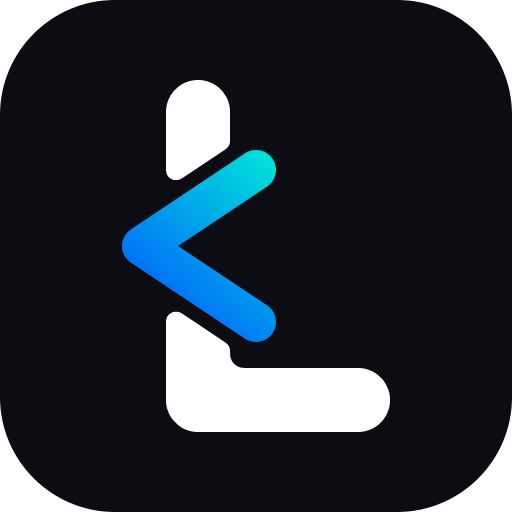

# LibreGram Desktop

**Твой Telegram. Твои правила. Твой интерфейс.**

Независимый настольный Telegram-клиент с упором на глубокую персонализацию, удобное управление аккаунтами, локальные расширения и контроль над подключением.

> [!WARNING]
> **LibreGram находится на ранней стадии разработки.** Возможности, описанные в документации, являются планами, пока они не реализованы и не прошли тестирование.

## 🇷🇺 О проекте

LibreGram — самостоятельный проект с собственным видением настольного Telegram-клиента. Мы хотим создать не просто очередной форк, а цельное приложение, в котором интерфейс, инструменты и дополнительные функции подчиняются единой концепции.

### Что планируется

- **LibreTheme** — мощная система оформления: цвета, шрифты, размеры, отступы, обои, анимации, пользовательские темы и CSS-подобная настройка.
- **Local Premium** — набор расширенных локальных возможностей клиента. Не путать с Telegram Premium: серверные привилегии не разблокируются.
- **Multi-account** — единый каталог до 500 отдельных рабочих профилей с изолированными данными. Создание, поиск и отдельный запуск уже реализованы; избранные и недавно использовавшиеся профили показываются первыми. Для каждого профиля доступны группа и до восьми меток.
- **LibreProxy** — необязательный модуль управления локальным прокси на основе [Flowseal/tg-ws-proxy](https://github.com/Flowseal/tg-ws-proxy).
- **Refined UX** — плавные анимации, продуманные переходы, улучшенная работа с медиа, быстрые действия и настраиваемые элементы интерфейса.
- **Privacy controls** — понятное управление локальными данными, настройками и дополнительными инструментами подключения.

### Документация

| Документ | Содержание |
|---|---|
| [Концепция и функции](docs/PRODUCT.md) | Полное описание идеи, модулей, поведения и ограничений |
| [Архитектура](docs/architecture.md) | Техническое устройство и принципы разработки |
| [Брендинг](docs/BRANDING.md) | Исходный логотип, ресурсы Qt, Windows и Linux |
| [Дорожная карта](docs/ROADMAP.md) | Этапы от концепции до первой публичной версии |
| [Аудит исходников](docs/UPSTREAM_AUDIT.md) | Что уже реализовано в базе и как расширять её без дублирования |
| [Профили и аккаунты](docs/MULTI_ACCOUNT.md) | Изолированные профили рабочих областей и цель в 500 сохранённых профилей |
| [Сборка Linux](docs/building-linux.md) | Инструкция по сборке исходной кодовой базы |
| [Сборка Windows](docs/building-win.md) | Инструкция по сборке Windows |
| [WEB proxy](docs/web-proxy-plan.md) | Отдельная документация унаследованного механизма WEB proxy |

## 🇬🇧 About

LibreGram Desktop is an independent desktop Telegram client with its own product vision. The goal is to build a cohesive application focused on deep customization, convenient account management, local enhancements and transparent connection controls.

### Planned highlights

- **LibreTheme:** extensive UI customization, wallpapers, animations, theme presets and a CSS-inspired styling format.
- **Local Premium:** client-side enhancements only, not Telegram Premium entitlements.
- **Multi-account:** account workspace with quick switching, search, favorites, one group and up to eight tags per profile. Long-term target: up to 500 saved profiles.
- **LibreProxy:** optional integration with [Flowseal/tg-ws-proxy](https://github.com/Flowseal/tg-ws-proxy).
- **Refined UX:** polished animations, media handling, shortcuts and customizable interface elements.
- **Privacy controls:** clear management of local data and connection tools.

Read the [product specification](docs/PRODUCT.md), [architecture](docs/architecture.md), [roadmap](docs/ROADMAP.md) and [source audit](docs/UPSTREAM_AUDIT.md).

## Статус проекта

| Направление | Состояние |
|---|---|
| Концепция и документация | В работе |
| Аудит исходной кодовой базы | Выполнен, см. UPSTREAM_AUDIT.md |
| Идентичность приложения | Логотип подключён к ресурсам Windows и Linux; сборка ожидает проверки |
| Базовая сборка | Не проверена |
| LibreTheme | Запланировано |
| Multi-account | Каталог до 500 профилей, создание, поиск, запуск, избранное, группы и метки реализованы; архивирование и импорт/экспорт в работе |
| LibreProxy | Запланировано |
| Local Premium | Запланировано |

## Принципы

1. **Самостоятельная идентичность.** LibreGram имеет собственное название, интерфейс, документацию и направление развития.
2. **Сначала стабильность.** Новые функции не должны ломать базовую работу клиента.
3. **Локальное значит локальное.** Не выдаём возможности приложения за серверные привилегии Telegram.
4. **Безопасность аккаунтов.** Не публикуем сессии, ключи и секреты.
5. **Открытая разработка.** Изменения должны быть понятными, проверяемыми и документированными.

## Лицензия и происхождение

LibreGram использует открытую кодовую базу Telegram Desktop и компоненты проекта Kotatogram Desktop. Поэтому при распространении необходимо соблюдать применимые условия **GNU GPL v3.0**, сохранять авторские уведомления и указывать происхождение заимствованных компонентов. См. [LICENSE](LICENSE).

LibreGram — независимый проект. Он не связан с Telegram и не является официальным продуктом Telegram.

---

Development branch: `libregram/dev` · Independent community project.
